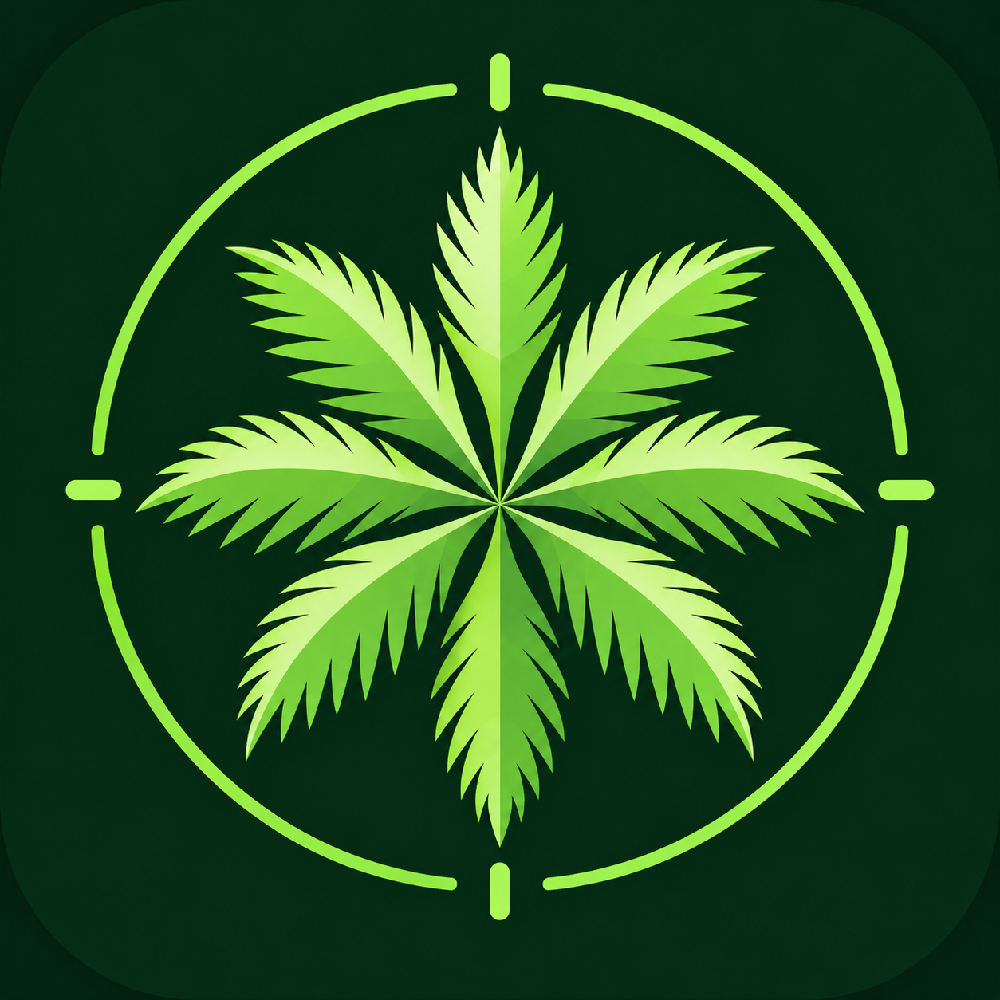

<p align="center">
  
</p>

# DrHorticulture

DrHorticulture is a mobile-first application for detecting and outlining palm-tree crowns in high-resolution aerial imagery.

The project combines a React interface, a FastAPI backend, and a custom-trained YOLO11 segmentation model. Users can upload an aerial image, inspect detected palms on an interactive spatial canvas, select individual crowns, and add or correct annotations.

> **Project status:** Working Capstone 2 research prototype. Palm detection and segmentation are operational. Palm-cluster detection is being tested, while palm-health classification remains a future stage.

## Contents

- [Purpose](#purpose)
- [Current capabilities](#current-capabilities)
- [Model findings](#model-findings)
- [How the system works](#how-the-system-works)
- [Repository structure](#repository-structure)
- [Requirements](#requirements)
- [First-time setup](#first-time-setup)
- [Running the application](#running-the-application)
- [Testing the model](#testing-the-model)
- [API overview](#api-overview)
- [Dataset and annotations](#dataset-and-annotations)
- [Development workflow](#development-workflow)
- [Current limitations](#current-limitations)
- [Next milestones](#next-milestones)
- [Additional documentation](#additional-documentation)

## Purpose

The project investigates whether YOLO segmentation can support the DrHorticulture workflow:

1. Upload a high-resolution aerial image.
2. Detect the majority of visible individual palm crowns.
3. Display crown outlines over the original image.
4. Allow a person to review, add, edit, or remove annotations.
5. Save those corrections for future model training.
6. Represent dense, inseparable groups as palm clusters.
7. Eventually estimate the health of each detected palm or cluster.

The model is intended to accelerate human review, not eliminate it. Some palms may remain undetected, especially inside dense clusters, shadows, or visually ambiguous vegetation.

## Current capabilities

| Capability                                   | Status                     |
| -------------------------------------------- | -------------------------- |
| Upload aerial JPG or PNG imagery             | Working                    |
| Run YOLO segmentation through the local API  | Working                    |
| Process large images using overlapping tiles | Working                    |
| Display detected crown polygons              | Working                    |
| Pan and zoom across the aerial image         | Working                    |
| Select and inspect individual detections     | Working                    |
| Add or edit palm outlines                    | Working                    |
| Save corrected annotations locally           | Working                    |
| Detect a dedicated `Palm Cluster` class      | Experimental, not deployed |
| Automatically retrain from saved corrections | Not implemented            |
| Estimate palm health                         | Not implemented            |
| Production database and authentication       | Not implemented            |

## Model findings

The application currently uses the custom Palm V3 YOLO11 segmentation model:

```text
backend/models/palm_v3_best.pt
```

Palm V3 was trained using annotations from eight approximately 5000 × 5000 aerial images:

```text
B, C, D, F, G, J, K, and L
```

Image **H** was kept outside the training set and used for held-out evaluation.

### Palm V3 dataset summary

| Split      | Source images | Tiles | Positive tiles | Tiled instances |
| ---------- | ------------: | ----: | -------------: | --------------: |
| Training   |             8 |   200 |            133 |           1,037 |
| Validation |             1 |    25 |              7 |             159 |

Preserved Palm V3 experiment metadata reports 941 source palm polygons across the eight training images and 152 source palm polygons for held-out image H. The repository does not currently contain independently recountable ground-truth geometry for J or H, so exact reconstruction of the original training and validation label set remains incomplete. The deployed weights and evaluation evidence remain preserved and usable.

Tiled-instance counts are higher because crowns crossing tile boundaries can appear as clipped objects in multiple overlapping tiles.

### Held-out evaluation on image H

| Metric                                          | Result |
| ----------------------------------------------- | -----: |
| Mask precision                                  |  59.1% |
| Mask recall                                     |  69.8% |
| Mask mAP50                                      |  67.3% |
| Mask mAP50–95                                   |  33.7% |
| Recall at the application threshold (`0.10`)    |  78.6% |
| Precision at the application threshold (`0.10`) |  55.8% |
| F1 score at the application threshold (`0.10`)  |  65.3% |

These results support continuing with YOLO for the project. At the application threshold, Palm V3 found approximately 79% of the labeled palms in the held-out image. This meets the current objective of identifying the majority of visible palms for human review.

The model should not be presented as fully autonomous. Dense palm clusters remain the main source of missed individual crowns. A separate cluster class is now being explored to represent areas where individual palms cannot be separated reliably.

Detailed results, metrics, curves, and prediction previews are available in:

```text
docs/experiments/palm-v3/
```

See [docs/model-card.md](docs/model-card.md) for the complete model description.

## How the system works

```text
Aerial image
     |
     v
React upload interface
     |
     v
FastAPI analysis endpoint
     |
     v
Overlapping 1280 × 1280 inference windows with a 1024-pixel stride
     |
     v
Palm V3 YOLO11 segmentation
     |
     v
Convert masks to original-image coordinates
     |
     v
Merge duplicate tile-edge detections
     |
     v
Return palm polygons to the interface
     |
     v
Human review and annotation corrections
```

Large images are divided into overlapping tiles because resizing the complete image to a normal model input size would remove important small-object detail.

Predictions from neighboring tiles are translated back into the coordinate system of the original image. Duplicate detections created by tile overlap are merged before the final polygons are returned to the frontend.

## Repository structure

```text
drhorticulture/
├── backend/
│   ├── app/                         # FastAPI application and inference logic
│   ├── data/
│   │   └── analyses/                # Runtime uploads and results; ignored by Git
│   ├── models/
│   │   └── palm_v3_best.pt          # Deployed YOLO segmentation weights
│   └── requirements.txt             # Python dependencies
├── data/
│   ├── source-images/               # Nine authorized aerial images
│   ├── annotations/
│   │   ├── source/                  # Original nine-image CVAT annotations
│   │   ├── palm-v3-reviewed/        # Reviewed labels used for Palm V3
│   │   └── latest-cvat/             # Newer palm and cluster annotations
│   └── README.md                    # Dataset documentation
├── docs/
│   ├── experiments/
│   │   └── palm-v3/                 # Metrics, curves, manifest, and previews
│   ├── annotation-workflow.md
│   ├── architecture.md
│   ├── dataset.md
│   ├── experiment-history.md
│   ├── known-limitations.md
│   └── model-card.md
├── public/                           # Static assets and application icon
├── src/                              # React frontend
├── CONTRIBUTING.md                  # Team development workflow
├── README.md                        # Project entry point
└── roadmap.md                       # Product-development roadmap
```

## Requirements

Install the following before running the project:

- Git
- Node.js with npm
- Python 3.12
- A modern browser such as Chrome or Edge

A CUDA-compatible GPU is optional. The included model can run on CPU, although a complete high-resolution image will take longer to process.

## First-time setup

### 1. Clone the repository using SSH

```bash
git clone git@github.com:ulicomp/drhorticulture.git
cd drhorticulture
```

If your computer uses a custom GitHub SSH host alias, use that configured alias in place of `github.com`.

### 2. Install frontend dependencies

```bash
npm install
```

### 3. Create the Python environment

#### Windows PowerShell

```powershell
python -m venv .venv
.\.venv\Scripts\Activate.ps1
python -m pip install --upgrade pip
pip install -r backend\requirements.txt
```

If PowerShell prevents environment activation, the application scripts can still use the Python executable inside `.venv` directly.

## Running the application

The frontend and API run as two separate local processes.

### Terminal 1: Start the API

On Windows:

```bash
npm run dev:api
```

The API should become available at:

```text
http://127.0.0.1:8011
```

Verify it by opening:

```text
http://127.0.0.1:8011/api/health
```

### Terminal 2: Start the frontend

```bash
npm run dev
```

Open the local URL printed by Vite, normally:

```text
http://127.0.0.1:3000
```

Keep both terminals running while using the application.

## Testing the model

A quick test can be performed with one of the included images.

1. Start the API and frontend.
2. Open the application in a browser.
3. Select an image from `data/source-images/`.
4. Upload the image.
5. Wait while the backend divides it into tiles and runs inference.
6. Inspect the generated crown polygons.
7. Select individual detections to examine them.
8. Add or correct outlines where necessary.
9. Save the reviewed annotations.

High-resolution images can take several minutes on CPU. Processing time depends on image dimensions, tile count, computer hardware, and model settings.

Saving annotations does **not** automatically retrain or replace the deployed model. Corrections must first be reviewed and added to a versioned training dataset.

## API overview

| Method | Endpoint                                 | Purpose                             |
| ------ | ---------------------------------------- | ----------------------------------- |
| `GET`  | `/api/health`                            | Confirm that the backend is running |
| `POST` | `/api/analyze`                           | Upload and analyze an aerial image  |
| `GET`  | `/api/analyses/{analysisId}`             | Retrieve a saved analysis           |
| `PUT`  | `/api/analyses/{analysisId}/annotations` | Save reviewed annotations           |

Local application analyses are written under:

```text
backend/data/analyses/
```

This runtime directory is excluded from Git. It may contain duplicate uploaded images, generated predictions, and local review data that do not belong in the canonical dataset.

## Dataset and annotations

The repository includes the nine aerial images used during the Palm V3 experiments and their associated annotation snapshots. The product owner provided or approved these materials for use by the DrHorticulture Capstone 2 team.

```text
data/
├── source-images/              # B, C, D, F, G, H, J, K, and L
├── annotations/
│   ├── source/                 # Original annotations for all nine images
│   ├── palm-v3-reviewed/       # Palm V3 reviewed labels
│   └── latest-cvat/            # Newer palm and Palm Cluster work
└── README.md
```

### Repository storage

The nine approved source images are intentionally stored in ordinary Git so authorized teammates receive the working dataset through a normal clone. Every individual file is below GitHub's 100 MB file limit, and the current first-commit scope is approximately 166 MiB. Git LFS should be reconsidered if the dataset or model collection grows substantially.

### Palm V3 snapshot

Palm V3 used:

- Reviewed active-learning labels for B, C, D, F, and L.
- Previously trusted annotation geometry for G and K.
- A J count preserved in Palm V3 experiment metadata, although the J ground-truth geometry is not currently present.
- H exclusively as held-out validation, with its count preserved in experiment metadata rather than recountable geometry.

The reviewed Palm V3 counts were:

| Image              | Individual palms |
| ------------------ | ---------------: |
| B                  |              133 |
| C                  |              130 |
| D                  |               38 |
| F                  |              215 |
| G                  |              124 |
| J                  |              128 |
| K                  |              128 |
| L                  |               45 |
| **Training total** |          **941** |
| H, held out        |              152 |

The J=128 and H=152 counts above come from the preserved Palm V3 experiment manifest and summary. Because the committed annotation files do not contain J or H polygon geometry, the reported 941-palm training total depends partly on historical metadata. Recovering those labels is a dataset-reproducibility follow-up; meanwhile, the application can run inference with the preserved Palm V3 weights. See [data/README.md](data/README.md) for the authoritative evidence and image-format notes.

### Latest CVAT snapshot

The newer CVAT snapshot contains:

| Image     | Individual palms | Palm clusters |   Total |
| --------- | ---------------: | ------------: | ------: |
| B         |              160 |            24 |     184 |
| C         |              135 |            19 |     154 |
| D         |               38 |             0 |      38 |
| F         |              215 |             0 |     215 |
| L         |               10 |             0 |      10 |
| **Total** |          **558** |        **43** | **601** |

This snapshot is newer than Palm V3 for B and C because additional palms and cluster polygons were added.

The L frame is incomplete in the latest CVAT snapshot. The complete reviewed 45-palm L label used by Palm V3 remains preserved under `data/annotations/palm-v3-reviewed/`.

Do not mix these snapshots without creating and documenting a new dataset version.

See [data/README.md](data/README.md) for the complete dataset guide.

## Development workflow

Use small branches and pull requests so changes can be reviewed without destabilizing the working prototype.

```bash
git checkout main
git pull
git checkout -b feature/short-description
```

After making and testing a focused change:

```bash
git add .
git commit -m "Describe the change"
git push -u origin feature/short-description
```

Open a pull request on GitHub and have another team member review it before merging.

Before submitting a change:

- Confirm the frontend still builds.
- Confirm the API starts.
- Test an aerial-image upload.
- Check that selection, panning, zooming, and annotation behavior still work.
- Do not commit `.venv`, `node_modules`, runtime uploads, temporary tiles, caches, or generated training runs.
- Keep approved source images and versioned annotations organized under `data/`.
- Document all model, dataset, class, or threshold changes.
- Do not replace the deployed weights without comparing the new model against the held-out evaluation data.

See [CONTRIBUTING.md](CONTRIBUTING.md) for the complete team workflow.

## Current limitations

- The training dataset contains only eight training scenes and one held-out scene.
- Accuracy across new locations, flight conditions, sensors, seasons, or resolutions is not established.
- Dense clusters can contain several palms that Palm V3 cannot separate.
- Lower confidence thresholds improve recall but also increase false positives.
- The experimental cluster class has not yet been trained and evaluated as a deployed model.
- Health classification has not been trained or validated.
- User corrections are saved locally but do not automatically enter a retraining pipeline.
- The API uses local filesystem storage and is not ready for multi-user deployment.
- No authentication, cloud storage, or production database is currently included.

See [docs/known-limitations.md](docs/known-limitations.md) for additional details.

## Next milestones

1. Complete a consistent review of the remaining cluster annotations.
2. Correct the incomplete L frame in the latest CVAT snapshot.
3. Create a versioned two-class dataset containing `Palm` and `Palm Cluster`.
4. Compare controlled data-augmentation experiments.
5. Retrain and evaluate a new model against the same held-out source image.
6. Replace Palm V3 only if the new model improves the agreed metrics or review workflow.
7. Create a repeatable annotation-to-training pipeline.
8. Add dataset and model version tracking.
9. Research and validate a separate palm-health assessment stage.
10. Prepare the backend for shared or cloud deployment.

## Additional documentation

| Document                                           | Purpose                                                  |
| -------------------------------------------------- | -------------------------------------------------------- |
| [Dataset guide](data/README.md)                    | Included images, annotation snapshots, counts, and usage |
| [Dataset methodology](docs/dataset.md)             | Annotation policy, splitting, tiling, and validation     |
| [Model card](docs/model-card.md)                   | Palm V3 purpose, performance, and appropriate use        |
| [Experiment history](docs/experiment-history.md)   | Training rounds and observed improvements                |
| [Annotation workflow](docs/annotation-workflow.md) | CVAT review and dataset-export process                   |
| [Architecture](docs/architecture.md)               | Frontend, API, inference, and storage design             |
| [Known limitations](docs/known-limitations.md)     | Technical limitations and project risks                  |
| [Contributing](CONTRIBUTING.md)                    | Branching, testing, and pull-request workflow            |
| [Roadmap](roadmap.md)                              | Planned application development                          |

## Project team

DrHorticulture is being developed as a Capstone 2 project. The included code, model, dataset, and documentation allow authorized team members to reproduce the current prototype and continue its development.

## Repository use and licensing status

No public open-source license has been selected for this repository. The repository, included imagery, annotations, and model artifacts are currently intended for the authorized DrHorticulture Capstone team. The product owner supplied and approved the imagery for the team's project work.

Broader public or commercial redistribution requires a separate licensing decision. Third-party software and model components, including Ultralytics packages and assets, remain subject to their respective licenses.
